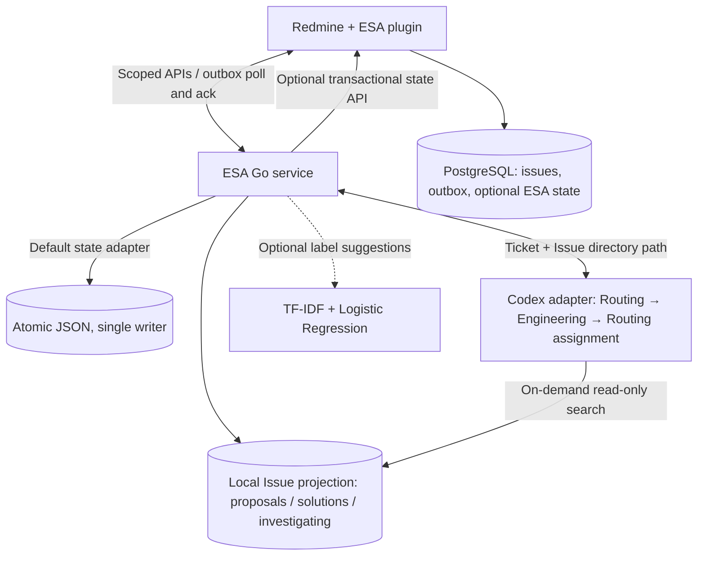
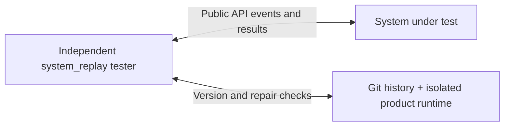

# ESA

ESA connects customer support and engineers through a Redmine plugin and an independent Go service. Engineering diagnosis is read-only: deliver root-cause candidates, evidence, repair recommendations, and verification steps.

This repository contains ESA code and deployment definitions. Redmine is referenced through the official `redmine:7.0.2-bookworm` Docker image; only the ESA plugin is maintained here. See [external dependencies and fresh-checkout setup](docs/DEPENDENCIES.md). Preserved Jira data, Kafka source, credentials, local tools, compiled artifacts and runtime reports are excluded from Git.

## Implementation

- Native Redmine ESA pages for ticket lists, filters, Jira JSON/CSV import, manual forwarding and engineer review; live status, a separate report page and one-click metadata suggestions.
- Durable, idempotent intake of manually forwarded snapshots with project and issue visibility checks.
- Routing Agent retrieval from local Issue directories, reusing Agent analyses or engineer solutions without another engineering call.
- On-demand engineering workers (maximum three), with isolated task environments, code evidence and advisory token warnings.
- Optional TF-IDF + Logistic Regression label suggestions, human feedback and independent training/testing; disabled by default.
- Independent API-based system replay with historical Git repair checks, reusable isolated runtimes and cleanup.
- Shared investigations, immutable snapshots/solution revisions, automatic capability planning, versioned Profiles and sandbox-local tools. See [ESA operations](docs/ESA_OPERATIONS.md).
- A shared preinstalled tool image with Soot/SootUp bytecode analysis, stable-release checks and per-Profile TXT configuration. See [tool environment](docs/TOOL_IMAGES.md).

## Architecture

Redmine owns source issues and user permissions. The Ruby ESA plugin provides the UI, imports and a durable forwarding outbox stored in PostgreSQL. The Go service polls the outbox and acknowledges events after committing them; the plugin calls its scoped HTTP APIs to display results and submit human reviews.

The Go service builds scoped local Issue directories and runs a bounded pipeline: intake routing, up to three engineering workers, then assignment routing. A persisted `investigating` claim lets matching tickets join work already in progress. It uses atomic JSON by default. Matching tickets share investigations and reviewed solutions. A transactional Redmine PostgreSQL adapter can replace JSON as the single state authority. The Codex Routing Agent searches this directory on demand. Reuse skips engineering; for new problems, the adapter resolves registered source and the engineering Agent plans approved tools and returns read-only findings plus an Issue grouping request. Routing Agent makes the final membership decision.

The optional classifier runs locally in Go and supplies label suggestions only. Human corrections are exported to the independent `esa-classifier` CLI for training and testing; an operator promotes a tested model and restarts the service. Classification does not control manual forwarding or engineering routing.



Replay runs separately from the business workflow:



`system_replay` is a separate Go module that exercises the system through public APIs. It freezes observed diagnoses before inspecting later mainline Git history, then verifies candidate repairs in an independent product runtime. It imports no ESA application packages and does not implement the system's ticket-processing decisions. Application-level tests live alongside the code they verify: case history tests in `internal/esa` and historical Jira snapshot tests in `internal/replay`.

## Ticket workflow

* Create or import an ordinary Redmine issue and prepare its diagnostic metadata. These actions do not submit it to ESA.
* An authorized user selects **Forward to ESA**. The durable outbox sends the snapshot with the human actor and forwarding time.
* Every forwarded open issue enters a shared task, independent of Tracker or metadata completeness. Go exports a historical, project-scoped local Issue directory and sends its path/hash instead of Issue or case bodies. Identical diagnostic inputs share an investigation.
* The Routing Agent searches and reads the directory. Both `agent_analyzed` proposals and `engineer_resolved` solutions can be reused, with engineer solutions preferred when applicable. Reuse returns the stored solution and skips the engineering Agent and sandbox setup. Ordinary non-engineering requests return to customer support without an engineering call. Matching `investigating` records join the existing task without another engineering call. Otherwise it requests essential information or queues new read-only engineering analysis; at most three engineering environments run concurrently. See [Issue directory and routing](docs/ISSUE_DIRECTORY.md).
* Engineering returns findings and a grouping request without catalogue access or an Issue ID. Routing Agent decides existing/new grouping; ESA validates its decision before linking or creating an Issue. Engineer review updates canonical solution provenance. Reuse stores a reference with a separate applicability review and never duplicates knowledge or promotes an Agent proposal to trusted status. Membership edits change links only; reanalysis requires explicit forwarding. ESA does not modify product source or close Redmine issues.
* Forward a resolved issue to collect a case. An identical already reviewed resolution inherits canonical trust; other cases start as drafts. Linked cases share the solution's approval and withdrawal state. Approved knowledge enters subsequent eligible directory views. Forward later source changes to withdraw obsolete evidence.

ESA automatically removes empty Engineering Issues and retains at most 100 globally, evicting the least recently accessed. Historical reports remain available; see [retention policy](docs/ESA_OPERATIONS.md#issue-retention).

The optional classifier supplies label suggestions alongside this workflow. Human confirmation and feedback training do not control admission, engineering routing or case approval. See [manual forwarding](docs/MANUAL_FORWARDING.md) and [backend workflow](docs/ESA_BACKEND_WORKFLOW.md).

## Repository layout

| Path | Responsibility |
| --- | --- |
| `cmd/esa`, `internal/esa` | Go HTTP service, manual intake, diagnosis orchestration, cases and durable state |
| `plugins/redmine_esa` | Native Redmine UI, authorization, imports and forwarding outbox |
| `cmd/esa-classifier`, `internal/classifier` | Optional local classifier and independent supervised training/testing |
| `cmd/esa-codex`, `internal/codex` | Read-only engineering provider and historical evidence validation |
| `internal/capabilities`, `profiles`, `internal/replaytools` | Approved plans, versioned Skills and isolated typed tools |
| `internal/retrieval` | Eligible-corpus BM25 for local Issue search |
| `system_replay` | Independent Go module for external API replay and subsequent Git repair evaluation |
| `internal/replay` | Historical ticket snapshots and source exports, with temporal snapshot tests |
| `deploy`, `scripts`, `docs`, `examples` | Deployment definitions, command wrappers, documentation and synthetic fixtures |

## Run

The local Compose configuration publishes Redmine at http://127.0.0.1:8080/. Follow [fresh-checkout setup](docs/DEPENDENCIES.md) for the required runtime and private deployment configuration. Enable the **ESA** project module and grant View ESA, Submit ESA, and Review ESA permissions to the appropriate roles. Uploading also requires Add issues permission.

Build using Go 1.27 or the verified project-local toolchain:

```sh
./scripts/build_esa.sh
mkdir -p runtime/esa/issues
DOCKER_CONTEXT=colima-redmine docker-compose -f deploy/redmine/compose.yaml build redmine esa
DOCKER_CONTEXT=colima-redmine docker-compose -f deploy/redmine/compose.yaml up -d
```

The build produces Linux ARM64 `bin/esa` and host binaries for `esa-host`, `esa-replay`, `esa-codex` and `esa-classifier`. Set `ESA_GO_ARCH=amd64` for an AMD64 service deployment. No external Go modules or Python packages are required. Building does not activate an existing deployment: rebuild and restart its images to use updated code. The Redmine service runs plugin migrations at startup, including the migration adding manual forwarding provenance to the outbox.

Stop ESA host processes, Redmine services and temporary test environments, then shut
down the dedicated Colima VM:

```sh
python3 -B scripts/shutdown.py
```

Use `--dry-run` to preview or `--keep-vm` to leave Colima running. Persistent data,
reports and tool caches are retained. Other projects' running containers prevent VM
shutdown. See [shutdown scope and cleanup](docs/ESA_OPERATIONS.md#shutdown-and-cleanup).

For direct development, configure a service token and use a separate store:

```sh
export ESA_API_TOKEN='<at least 24 random characters>'
.tools/go/bin/go run ./cmd/esa -listen 127.0.0.1:8090 -store runtime/dev/state.json
```

The service token in `deploy/redmine/.env` is private. The browser never receives it. The plugin derives project and issue visibility from the current Redmine user. The Go service is reachable only inside the Compose network.

Run a JSON ticket through Routing Agent and download the provider's runtime events:

```sh
python3 scripts/analyze_ticket.py examples/agent-ticket.json \
  --routing-provider http://127.0.0.1:8091 --output runtime/ticket-example
```

Start the registered provider first. The script defaults to an isolated real ESA service and stops it on exit; `--esa-url` targets an existing service configured for that provider. Routing determines whether engineering is needed. Event logs and results stay in the new output directory. See [ticket runner and weighted token alerts](docs/ESA_OPERATIONS.md#ticket-runner-and-runtime-logs). Cached input counts at 0.1 for advisory alerts; uncached input/output count at 1.

## Jira dataset layout

Preserved Jira exports live under `data/jira/raw/YYYY/MM/DD/KEY.json`, grouped by the original `issue.fields.created` timestamp converted to UTC. For example: `data/jira/raw/2015/11/24/KAFKA-2880.json`. Dates describe ticket creation, not download time or historical snapshot completeness.

Preview or apply the layout (Python 3.9+, macOS/Linux):

```sh
python3 scripts/organize_jira_data.py
python3 scripts/organize_jira_data.py --apply
```

An optional positional argument selects another dataset root containing `raw/`. The script validates the full batch, preserves JSON bytes and modification times, records original/new paths and SHA-256 in `index/created-layout-*.json`, then verifies every relocated file. Invalid dates, duplicate keys and existing destinations fail without overwriting exports. Interrupted moves retain their manifest; rerunning continues from the files' current locations. Repeated runs on an organized dataset move nothing. The downloader uses the same dated layout for new files and skips existing keys recursively; auditing supports both flat and dated layouts. A shared writer lock prevents these updated tools from downloading and relocating simultaneously. Stop older downloader processes before migration.

Organization preserves the original `index/issue_keys.json` and `index/download_report.json`. Local data and migration manifests remain ignored by Git.

The downloader lives in `scripts/`. Normal mode resumes missing downloads; incremental mode also refreshes changed exports:

```sh
python3 scripts/kafka_jira_downloader.py --jql 'project = KAFKA ORDER BY created ASC' --limit 0
python3 scripts/kafka_jira_downloader.py --incremental
python3 scripts/kafka_jira_downloader.py --incremental --keys KAFKA-2880 KAFKA-3252
```

An incremental search scans lightweight issue keys and `fields.updated` using Jira's [field-filtered search API](https://developer.atlassian.com/server/jira/platform/rest/v10003/api-group-search/), downloading full issue details, comments and changelog only for missing, newer or locally incomplete exports. Explicit keys use a lightweight issue-header request instead of a project search. Timestamps are compared as UTC instants. It uses no high-water mark, so a failed download remains eligible on the next pass. Missing remote timestamps trigger a conservative full fetch. Changes that Jira does not reflect in `updated` cannot be detected by timestamp comparison.

By default, the saved dataset JQL is reused (this archive uses all Kafka issue types); a new dataset defaults to Kafka bugs. `--jql` overrides the current run's query without replacing an existing corpus scope. `--incremental` inspects all matches unless limited with `--limit`; normal mode defaults to 20. `--output` selects another dataset root. A limited run or explicit-key retry preserves the full known-key index. The default page size is 100, with server-returned page lengths respected. Requests remain sequential with delay/retry/backoff.

Before replacing an existing export, its exact bytes are saved under `history/KEY/SHA256.json`; `raw/` remains the latest copy in the creation-date layout. Complete histories are not replaced by incomplete responses, and older responses or changed creation dates are rejected. Writes are atomic. Remote deletions are not mirrored. `index/download_report.json` records the latest run's downloaded/updated/skipped counts, failures and archive paths. The script does not forward tickets to ESA. Tests use local fixtures and make no Jira calls:

```sh
python3 -B -m unittest discover -s scripts -p 'test_jira*.py' -v
```

## Optional classifier

`config/rules.json` ships with `classifier.enabled: false`. When enabled for a project, a user with **Submit ESA** can request **Suggest labels** on a forwarded ticket; a user with **Review ESA** confirms or corrects the complete label set. Opening the page and forwarding a ticket do not automatically run the classifier.

The Go implementation uses TF-IDF features and independent Logistic Regression models for multiple labels. Online features are limited to the last forwarded subject and description. Labels come from human-reviewed training data or an explicit training label set. Scores are advisory and uncalibrated; inputs with no known features abstain. Classification makes no Agent calls.

After building, run the independent commands from the repository root:

```sh
bin/esa-classifier train \
  -data examples/classifier/train.jsonl \
  -cutoff 2025-01-01T00:00:00Z \
  -output runtime/classifier/demo-candidate.json
bin/esa-classifier test \
  -model runtime/classifier/demo-candidate.json \
  -data examples/classifier/test.jsonl
bin/esa-classifier predict \
  -model runtime/classifier/demo-candidate.json \
  -text 'Consumer crash null pointer and slow latency regression'
```

Each output model path must be new. These fixtures are synthetic; their results do not establish accuracy on real Jira tickets. Raw Jira exports require curation into reviewed JSONL examples with stable ticket IDs, project IDs, snapshot text, complete human labels, reviewer and review time. Testing rejects training-group/text overlap and requires later held-out reviews. Metrics include per-label and micro/macro F1, exact label-set accuracy, Hamming loss and abstentions.

Human feedback retains the exact predicted snapshot, model version, reviewer and review time. Export it at an explicit cutoff and create a new candidate:

```sh
bin/esa-classifier retrain \
  -data runtime/classifier/human-training.jsonl \
  -feedback runtime/classifier/feedback.jsonl \
  -cutoff 2026-10-13T00:00:00Z \
  -output runtime/classifier/candidate-updated.json
```

Retraining uses the newest human correction per ticket at the cutoff and fully refits TF-IDF and Logistic Regression. Keep the test population out of both base training data and feedback. Test the candidate independently, then manually configure `classifier.enabled: true` and `classifier.models` with project-specific model paths and restart ESA. Container deployments also need read-only model/config mounts and appropriate file access for the service user. A historical snapshot cannot use a model trained from reviews after its forwarding time. There is no automatic model promotion.

See [classifier operations](docs/CLASSIFIER.md) for the JSONL contract, feedback export API, training options, model activation and temporal evaluation safeguards. Keep real datasets, feedback and models in ignored `runtime/` or `reports/` directories.

## Tests

GitHub Actions reuses the existing deterministic tests and API replay fixtures,
with no real Agent calls. Run the same check locally with
`sh scripts/check_workflow.sh`; see [CI and build candidates](docs/CI.md).
The separate manual **Deployment acceptance** workflow starts an isolated real
Redmine stack with the same fixture provider and verifies forwarding, review,
permissions, restart persistence and cleanup without real Agent calls.

```sh
GOCACHE="$PWD/.tools/go-cache" GOTOOLCHAIN=local .tools/go/bin/go test -race ./...
GOCACHE="$PWD/.tools/go-cache" GOTOOLCHAIN=local .tools/go/bin/go vet ./...
```

Use `examples/resolved-case.json` to import a resolved synthetic issue, manually forward it, then approve its case after reviewing the evidence. Upload `examples/new-issues.csv` and forward a selected issue to exercise routing. Reuse requires a configured Routing Agent and an applicable, inspected record; text similarity alone does not trigger a recommendation. Without a provider, open forwarded issues await configuration. Reopen the source issue and forward its changed snapshot to withdraw obsolete advice.

## External system replay

Build the opaque application artifact and the tester separately. Run from the repository root; every output directory must be new:

```sh
GOCACHE="$PWD/.tools/go-cache" GOTOOLCHAIN=local .tools/go/bin/go build -o bin/esa-host ./cmd/esa
sh scripts/build_system_replay.sh
python3 scripts/replay_pipeline.py --pipeline --manifest system_replay/examples/esa-api-lifecycle.json --output reports/new-lifecycle-run
python3 scripts/replay_pipeline.py --pipeline --manifest system_replay/examples/esa-api-kafka.json --output reports/new-kafka-run
python3 scripts/replay_pipeline.py --pipeline --manifest system_replay/examples/esa-api-forwarding.json --output reports/new-forwarding-run
```

The lifecycle example exercises the actual ESA public API: case collection/approval, duplicate and stale events, reopening, forwarded support requests and project permissions. It verifies that open tickets await configuration, even when an approved case exists; it does not test Agent-driven reuse. The Kafka example additionally runs historical client code before and after the upstream repair. Both start a fresh backend on port 18090 with a separate state file and disable Redmine synchronization. The lifecycle example needs no Kafka checkout or Jira export; the Kafka example needs those external inputs and Docker.

The defaults make no model calls. The explicitly forwarded Kafka ticket reaches `awaiting_configuration` without a provider; a successful runtime repair test does not establish engineering Agent accuracy. To test a provider, configure it in the system under test and update the external assertions. The tester never invokes that provider directly.

The separate `system_replay/examples/esa-shared-investigations.json` fixture uses a deterministic HTTP provider to test shared tasks and solution revisions without model calls.

See [manual forwarding](docs/MANUAL_FORWARDING.md), [architecture and evaluation](docs/TICKET_BACKTEST.md), [CLI operations](docs/REPLAY_PIPELINE.md), and [the standalone manifest/runtime contract](system_replay/README.md). Root application tests do not include the nested module:

```sh
GOCACHE="$PWD/.tools/go-cache" GOTOOLCHAIN=local .tools/go/bin/go -C system_replay test -race ./...
GOCACHE="$PWD/.tools/go-cache" GOTOOLCHAIN=local .tools/go/bin/go -C system_replay vet ./...
```

## Engineering provider

Without `ESA_ANALYZER_URL`, eligible open forwarded issues become **Awaiting configuration**, including support requests: there is no keyword admission gate. The normal Codex adapter checks the affected release before handing a new analysis to Engineering. Missing or ambiguous releases request clarification; a version without a project/cutoff-eligible source registration reports **Invalid or nonexistent version**. Both stop at **Awaiting information** without an engineering call. A prior evidence packet is optional and applies only to an explicitly matched scenario. See [provider setup and source selection](docs/ESA_OPERATIONS.md#source-registry-profiles-and-tools); [the historical replay trial](docs/CODEX_REPLAY_TRIAL.md) describes the separate fixed-packet utility.

The Codex adapter disables native host tools and exposes the registered ESA tools. Known releases can create a generic preset sandbox on demand without a prior evidence packet; the Agent builds unchanged frozen source and writes diagnostic helpers in scratch. Engineering selects tool-generated evidence IDs, and the provider derives source coordinates and exact quotes before validation. Token thresholds are advisory; the separate invocation limit and execution deadline still apply. CLI usage may arrive only when the turn finishes; missing usage is unknown. The service cannot independently restrict tools inside an arbitrary remote HTTP provider. See [tool environments](docs/TOOL_IMAGES.md) for preset tools and [system replay operations](docs/REPLAY_PIPELINE.md) for independent batch evaluation and cleanup.

## Current limits

This is a development implementation with synthetic workflow checks and focused Kafka runtime trials. These do not establish archive-wide Agent accuracy. Automatic customer environment inference, universal historical build profiles, document retrieval, recovery of unavailable historical comment bodies, archive-wide diagnosis/classifier accuracy validation, external release listening and universal runtime verification remain to be implemented. Replay profiles explicitly separate environment readiness from reproduction of a customer issue. Importing a current Jira export does not make it a valid historical snapshot.

The default state adapter uses atomic JSON with a single-writer process lock. The optional Redmine PostgreSQL adapter is implemented, but still writes a whole-state frame through transactional CAS with a 64 MiB limit; it is not a scalable row-level work queue. Both preserve immutable inputs and audit records. The plugin limits access to 2,000 visible ESA issues per request. Database migration, load testing and scalable authorization remain necessary before importing the full Jira archive. Source edits, reopening and resolution do not automatically reach ESA; manually forward updated visible snapshots. The plugin excludes current private issues from forwarding. Privacy changes affecting previously forwarded snapshots, cross-project moves, deletions and retroactive ingestion need a dedicated reconciliation mechanism. Backend snapshots marked private are excluded from shared analysis, case recommendations and classifier operations.

Original Jira export revisions are retained: organization preserves bytes, and incremental updates archive the previous revision. The `kafka/` checkout remains untouched. Old audit reports retain their original language and paths.

## Documentation

Build the English code reference with `./scripts/build_docs.sh` and open
`.tools/doxygen/html/index.html`. See [Doxygen and comment conventions](docs/DOXYGEN.md)
for dependencies, language coverage and output cleanup.

| Topic | Entry point |
| --- | --- |
| Generated code reference and comment conventions | [Doxygen](docs/DOXYGEN.md) |
| Fresh checkout and Redmine start/stop | [Dependencies](docs/DEPENDENCIES.md), [local deployment](deploy/redmine/README.md) |
| Support and engineer UI | [Manual forwarding](docs/MANUAL_FORWARDING.md), [frontend](docs/ESA_PLUGIN_FRONTEND.md) |
| Service, provider, storage, logs and limits | [Operations](docs/ESA_OPERATIONS.md), [backend/API workflow](docs/ESA_BACKEND_WORKFLOW.md) |
| Issue search, grouping and retention | [Issue directory](docs/ISSUE_DIRECTORY.md) |
| Preset images and approved tools | [Tool images](docs/TOOL_IMAGES.md) |
| Optional supervised classifier | [Classifier](docs/CLASSIFIER.md) |
| Independent replay and evaluation | [Architecture](docs/TICKET_BACKTEST.md), [CLI](docs/REPLAY_PIPELINE.md), [standalone contract](system_replay/README.md) |
| Specialized fixed-packet experiment | [Historical Codex trial](docs/CODEX_REPLAY_TRIAL.md) |

Current operating instructions describe the checked-in implementation. Ignored runtime reports retain the conditions and paths of their individual experiments; they are not deployment instructions or general accuracy claims.
