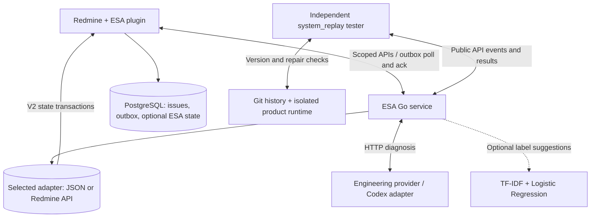

# ESA

ESA connects customer support and engineers through a Redmine plugin and an independent Go service. Engineering diagnosis is read-only: deliver root-cause candidates, evidence, repair recommendations, and verification steps.

This repository contains ESA code and deployment definitions. Redmine is referenced through the official `redmine:7.0.2-bookworm` Docker image; only the ESA plugin is maintained here. See [external dependencies and fresh-checkout setup](docs/DEPENDENCIES.md). Preserved Jira data, Kafka source, credentials, local tools, compiled artifacts and runtime reports are excluded from Git.

## Implementation

- Native Redmine ESA pages for ticket lists, filters, Jira JSON/CSV import, manual forwarding and engineer review.
- Durable, idempotent intake of manually forwarded snapshots with project and issue visibility checks.
- Trusted case reuse and collection of resolved cases, with human approval and recommendation withdrawal.
- Read-only engineering diagnosis through a Go Codex adapter, with code evidence and advisory token warnings.
- Optional TF-IDF + Logistic Regression label suggestions, human feedback and independent training/testing; disabled by default.
- Independent API-based system replay with historical Git repair checks, reusable isolated runtimes and cleanup.
- Opt-in V2 shared investigations, immutable snapshots/solution revisions, automatic capability planning, versioned Profiles and sandbox-local tools. See [V2 operations](docs/V2_OPERATIONS.md).
- Preinstalled Profile tool images with stable-release checks and per-Profile TXT configuration. See [tool images](docs/TOOL_IMAGES.md).

## Architecture

Redmine owns source issues and user permissions. The Ruby ESA plugin provides the UI, imports and a durable forwarding outbox stored in PostgreSQL. The Go service polls the outbox and acknowledges events after committing them; the plugin calls its scoped HTTP APIs to display results and submit human reviews.

The Go service handles diagnostic context, trusted case retrieval and asynchronous engineering analysis. V1 uses atomic JSON. Opt-in V2 adds shared issues/tasks and can use a transactional Redmine PostgreSQL adapter as its single authority. The Codex adapter resolves registered historical source per task, validates automatic Profile/capability requests and returns read-only findings for review.

The optional classifier runs locally in Go and supplies label suggestions only. Human corrections are exported to the independent `esa-classifier` CLI for training and testing; an operator promotes a tested model and restarts the service. Classification does not control manual forwarding or engineering routing.



`system_replay` is a separate Go module that exercises the system through public APIs. It freezes observed diagnoses before inspecting later mainline Git history, then verifies candidate repairs in an independent product runtime. It imports no ESA application packages and does not implement the system's ticket-processing decisions. Application-level tests live alongside the code they verify: case history tests in `internal/esa` and historical Jira snapshot tests in `internal/replay`.

## Ticket workflow

* Create or import an ordinary Redmine issue and prepare its diagnostic metadata. These actions do not submit it to ESA.
*  An authorized user selects **Forward to ESA**. The durable outbox sends the snapshot with the human actor and forwarding time.
*   A forwarded open issue checks applicable trusted cases from the same project. If no case applies, missing context is requested or read-only engineering analysis is queued. This decision does not depend on a category or Tracker.
*    An engineer reviews the diagnosis, evidence, concrete code findings, repair recommendations and verification steps. ESA does not modify product source or automatically close the Redmine issue.
*    Forward a resolved issue to collect a case draft. Engineer approval makes it available for applicable recommendations on already forwarded tickets. Forward subsequent source changes to refresh or withdraw its evidence.

The optional classifier supplies label suggestions alongside this workflow. Human confirmation and feedback training do not control admission, engineering routing or case approval. See [manual forwarding](docs/MANUAL_FORWARDING.md) and [backend workflow](docs/ESA_BACKEND_WORKFLOW.md).

## Repository layout

| Path | Responsibility |
| --- | --- |
| `cmd/esa`, `internal/esa` | Go HTTP service, manual intake, diagnosis orchestration, cases and durable state |
| `plugins/redmine_esa` | Native Redmine UI, authorization, imports and forwarding outbox |
| `cmd/esa-classifier`, `internal/classifier` | Optional local classifier and independent supervised training/testing |
| `cmd/esa-codex`, `internal/codex` | Read-only engineering provider and historical evidence validation |
| `internal/capabilities`, `profiles`, `internal/replaytools` | Approved plans, versioned Skills and isolated typed tools |
| `internal/retrieval` | Eligible-corpus BM25/RRF |
| `system_replay` | Independent Go module for external API replay and subsequent Git repair evaluation |
| `internal/replay` | Historical ticket snapshots and source exports, with temporal snapshot tests |
| `deploy`, `scripts`, `docs`, `examples` | Deployment definitions, command wrappers, documentation and synthetic fixtures |

## Run

The local Compose configuration publishes Redmine at http://127.0.0.1:8080/. Follow [fresh-checkout setup](docs/DEPENDENCIES.md) for the required runtime and private deployment configuration. Enable the **ESA** project module and grant View ESA, Submit ESA, and Review ESA permissions to the appropriate roles. Uploading also requires Add issues permission.

Build using Go 1.27 or the verified project-local toolchain:

```sh
./scripts/build_esa.sh
DOCKER_CONTEXT=colima-redmine docker-compose -f deploy/redmine/compose.yaml build redmine esa
DOCKER_CONTEXT=colima-redmine docker-compose -f deploy/redmine/compose.yaml up -d
```

The build produces Linux ARM64 `bin/esa` and host binaries for `esa-replay`, `esa-codex` and `esa-classifier`. Set `ESA_GO_ARCH=amd64` for an AMD64 service deployment. No external Go modules or Python packages are required. Building does not activate an existing deployment: rebuild and restart its images to use updated code. The Redmine service runs plugin migrations at startup, including the migration adding manual forwarding provenance to the outbox.

For direct development, configure a service token and use a separate store:

```sh
export ESA_API_TOKEN='<at least 24 random characters>'
.tools/go/bin/go run ./cmd/esa -listen 127.0.0.1:8090 -store runtime/dev/state.json
```

The service token in `deploy/redmine/.env` is private. The browser never receives it. The plugin derives project and issue visibility from the current Redmine user. The Go service is reachable only inside the Compose network.

## Optional classifier

`config/rules.json` ships with `classifier.enabled: false`. When enabled for a project, a user with **Submit ESA** can request **Suggest labels** on a forwarded ticket; a user with **Review ESA** confirms or corrects the complete label set. Opening the page and forwarding a ticket do not automatically run the classifier.

The Go implementation uses TF-IDF features and independent Logistic Regression models for multiple labels. Online features are limited to the last forwarded subject and description. Labels come from human-reviewed training data or an explicit training label set. Scores are advisory and uncalibrated; inputs with no known features abstain. Classification makes no Agent calls.

After building, run the independent commands from the repository root:

```sh
bin/esa-classifier train \
  -data examples/classifier/train.jsonl \
  -cutoff 2025-01-01T00:00:00Z \
  -output runtime/classifier/demo-candidate.json
bin/esa-classifier test \
  -model runtime/classifier/demo-candidate.json \
  -data examples/classifier/test.jsonl
bin/esa-classifier predict \
  -model runtime/classifier/demo-candidate.json \
  -text 'Consumer crash null pointer and slow latency regression'
```

Each output model path must be new. These fixtures are synthetic; their results do not establish accuracy on real Jira tickets. Raw Jira exports require curation into reviewed JSONL examples with stable ticket IDs, project IDs, snapshot text, complete human labels, reviewer and review time. Testing rejects training-group/text overlap and requires later held-out reviews. Metrics include per-label and micro/macro F1, exact label-set accuracy, Hamming loss and abstentions.

Human feedback retains the exact predicted snapshot, model version, reviewer and review time. Export it at an explicit cutoff and create a new candidate:

```sh
bin/esa-classifier retrain \
  -data runtime/classifier/human-training.jsonl \
  -feedback runtime/classifier/feedback.jsonl \
  -cutoff 2026-10-13T00:00:00Z \
  -output runtime/classifier/candidate-v2.json
```

Retraining uses the newest human correction per ticket at the cutoff and fully refits TF-IDF and Logistic Regression. Keep the test population out of both base training data and feedback. Test the candidate independently, then manually configure `classifier.enabled: true` and `classifier.models` with project-specific model paths and restart ESA. Container deployments also need read-only model/config mounts and appropriate file access for the service user. A historical snapshot cannot use a model trained from reviews after its forwarding time. There is no automatic model promotion.

See [classifier operations](docs/CLASSIFIER.md) for the JSONL contract, feedback export API, training options, model activation and temporal evaluation safeguards. Keep real datasets, feedback and models in ignored `runtime/` or `reports/` directories.

## Tests

```sh
GOCACHE="$PWD/.tools/go-cache" GOTOOLCHAIN=local .tools/go/bin/go test -race ./...
GOCACHE="$PWD/.tools/go-cache" GOTOOLCHAIN=local .tools/go/bin/go vet ./...
```

Use `examples/resolved-case.json` to import a resolved synthetic issue, manually forward it, then approve its case after reviewing the evidence. Upload `examples/new-issues.csv` and manually forward the matching engineering issue to receive the trusted recommendation. Forward the usage question only if engineering assistance is needed. Reopen the source issue and forward its changed snapshot to withdraw the recommendation.

## External system replay

Build the opaque application artifact and the tester separately. Run from the repository root; every output directory must be new:

```sh
GOCACHE="$PWD/.tools/go-cache" GOTOOLCHAIN=local .tools/go/bin/go build -o bin/esa-host ./cmd/esa
sh scripts/build_system_replay.sh
python3 scripts/replay_pipeline.py --pipeline --manifest system_replay/examples/esa-api-lifecycle.json --output reports/new-lifecycle-run
python3 scripts/replay_pipeline.py --pipeline --manifest system_replay/examples/esa-api-kafka.json --output reports/new-kafka-run
python3 scripts/replay_pipeline.py --pipeline --manifest system_replay/examples/esa-api-forwarding.json --output reports/new-forwarding-run
```

The lifecycle example exercises the actual ESA public API: case collection/approval/reuse, duplicate and stale events, reopening, forwarded support requests and project permissions. The Kafka example additionally runs historical client code before and after the upstream repair. Both start a fresh backend on port 18090 with a separate state file and disable Redmine synchronization. The lifecycle example needs no Kafka checkout or Jira export; the Kafka example needs those external inputs and Docker.

The defaults make no model calls. The explicitly forwarded Kafka ticket reaches `awaiting_configuration` without a provider; a successful runtime repair test does not establish engineering Agent accuracy. To test a provider, configure it in the system under test and update the external assertions. The tester never invokes that provider directly.

See [manual forwarding](docs/MANUAL_FORWARDING.md), [architecture and evaluation](docs/TICKET_BACKTEST.md), [CLI operations](docs/REPLAY_PIPELINE.md), and [the standalone manifest/runtime contract](system_replay/README.md). Root application tests do not include the nested module:

```sh
GOCACHE="$PWD/.tools/go-cache" GOTOOLCHAIN=local .tools/go/bin/go -C system_replay test -race ./...
GOCACHE="$PWD/.tools/go-cache" GOTOOLCHAIN=local .tools/go/bin/go -C system_replay vet ./...
```

## Engineering provider

Without `ESA_ANALYZER_URL`, engineering issues become **Awaiting configuration**. The local trial connects the Go Codex adapter for one explicitly registered ticket/evidence packet. Other tickets are rejected before invoking a model. See [the Codex replay trial](docs/CODEX_REPLAY_TRIAL.md) for startup, isolation, audits and evaluation. The general HTTP contract remains in [the workflow document](docs/ESA_BACKEND_WORKFLOW.md).

The Codex adapter disables native host tools and exposes only four registered replay tools. It checks exact evidence quotes against frozen source or audited runtime output. Token thresholds are advisory; the separate invocation limit and execution deadline still apply. CLI usage may arrive only when the turn finishes; missing usage is unknown. The service cannot independently restrict tools inside an arbitrary remote HTTP provider. See [replay pipeline operations](docs/REPLAY_PIPELINE.md) for profiles, batch commands, permissions and cleanup.

## Boundaries of this first version

This is a working development foundation with one focused historical replay trial. Automatic customer environment inference, universal historical build profiles, document retrieval, recovery of unavailable historical comment bodies, archive-wide diagnosis/classifier accuracy validation, external release listening and universal runtime verification remain to be implemented. Replay profiles explicitly separate environment readiness from reproduction of a customer issue. Importing a current Jira export does not make it a valid historical snapshot.

State is stored as an atomic JSON snapshot with a single-writer process lock. It preserves immutable events, run inputs, case revisions, classifier predictions and human feedback; it is intended for this local prototype. The plugin limits access to 2,000 visible ESA issues per request. Move state to a transactional database and implement scalable authorization before importing the full Jira archive. Source edits, reopening and resolution do not automatically reach ESA; manually forward updated visible snapshots. The plugin excludes current private issues from forwarding. Privacy changes affecting previously forwarded snapshots, cross-project moves, deletions and retroactive ingestion need a dedicated reconciliation mechanism. Backend snapshots marked private are excluded from shared analysis, case recommendations and classifier operations.

Original `data/` and `kafka/` remain untouched. Old audit reports retain their original language.
