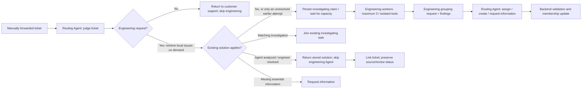

# Local Issue directory and routing

ESA keeps its Postgres store as the authority. The local Issue directory is a generated read-only projection for Agent retrieval, not another editable issue database. Neither Issue bodies nor a top-N candidate list are sent in the initial Agent context. The provider receives a relative directory path and manifest hash; it resolves the path under its operator-configured local root.

## Workflow



Routing has `issue_search` and `issue_read`, plus `issue_context` for the post-analysis request. Routing cannot inspect product code, install software or run debugging tools. Engineering has none of the Issue tools: the server rejects catalogue calls even if an obsolete registration contains directory paths. Only a new problem enters the engineering adapter and source registry. Reuse does not resolve source refs, prepare a runtime or invoke the engineering Agent. Each stage runs at most once per request; uncertain failures need explicit retry.

Both completed Agent proposals and engineer solutions can be reused. Engineer solutions take precedence when applicable; an Agent proposal need not wait for approval before reuse. Applicability remains a Routing Agent judgment about symptoms, component, version and environment. Agent proposals do not become trusted repairs through reuse. Reuse stores a reference to the original solution or case revision. Applicability to the new ticket has a separate review history; accepting it does not publish another knowledge revision or change the source review state. A changed or withdrawn source invalidates dependent applications. No ticket is automatically closed.

After empty Issue cleanup, Issues without engineer-reviewed knowledge are capped at 100 globally by least recent access; Issues with reviewed knowledge are never evicted by count. A solved Issue unmatched for `issue_retirement_days` is retired: its records stay in each view marked `retired`, `issue_search` leaves them out unless `archive` is true, and a later reuse or assignment revives the Issue and flags the ticket as a possible regression. Removed Issue IDs are excluded even when historical cases or solutions remain on disk. Successful `issue_read` operations count as accesses when the stage completes; `issue_search` and directory export do not. Standalone cases and frozen historical views are separate from this Issue count. See [retention policy](ESA_OPERATIONS.md#issue-retention).

## Pipeline and in-progress deduplication

The live service sends three named stages to the same Codex adapter: `route`, `engineer`, and `assign`. The latter two continue the audited run without repeating intake routing. Stage inputs bind the same immutable ticket, contract and directory hash. Successful stage reports are cached; atomic attempt directories prevent an interrupted stage from silently spending again. A failed or uncertain stage requires operator inspection and an explicit new run.

Before an `analyze` route is handed to Engineering, the adapter checks for one nonblank affected release and, in registry mode, a project/cutoff-eligible source registration. Missing or ambiguous releases request clarification; an unmatched registration reports **Invalid or nonexistent version**. A failed check returns an effective `request_information` route and **Awaiting information**, with one routing call and no engineering call, source export, investigation claim or sandbox setup. The raw Agent decision stays in `routing/answer.json`; the effective route and reason are in the cached report. Reuse, join and support-return routes skip the check. Compilation and reproduction remain Engineering responsibilities.

ESA runs four bounded consumers. The shipped `worker.max_active_per_project: 4` counts workflows that hold a worker (routing, engineering and assignment); operators may lower it. A task parked for an engineering slot holds no worker and does not count, so cheap reuse, clarification and support-return routing continue while all three slots are busy. Engineering capacity is a separate global hard limit of three, reserved in state transactions across workers/projects. The adapter independently caps engineering environments with `-concurrency` (default 3, range 1..3). Only a task routed to engineering can request a runtime; container creation remains lazy until a capability grant. Engineering cleanup releases its capacity before assignment routing, allowing the next task to start. With managed tools enabled, known releases can start a generic preset workspace without a scenario packet. It contains frozen source and tools, but no product build or reproducer. Explicit `-managed-tools=false` registrations remain source-only; unknown releases have no registered source/runtime.

Initial routing is serialized per project until its outcome or in-progress claim is committed. The expensive engineering stage does not hold that routing gate. `investigation.state: investigating` remains active while waiting for capacity, diagnosing and requesting grouping; `phase` distinguishes `waiting_engineering`, `investigating`, and `assignment`. Heartbeats, lease expiry and fencing protect all active phases. When every slot is busy, or another task is already waiting, the routed task is parked: its routing report and exact provider request are stored, and its worker and lease are released. When a slot frees, a worker resumes the oldest parked task, rotating across projects, under a new epoch, so the parking worker can no longer write. In-process workers are woken when a slot or worker frees; a one-second idle poll covers other processes sharing the state. The engineering deadline starts when a slot is reserved; waiting longer than `worker.max_queue_wait_seconds`, measured from parking, fails the task without an engineering call. Failed, superseded, private or replaced work is no longer offered as active advice; uncertain work is not automatically retried.

`investigating` is coordination metadata, not a third kind of solution. It contains only the earlier original ticket, scope and investigation identity, with no partial findings or repair. After an exact audited read, Routing Agent can return `join` with its path/hash and a concrete symptom match. ESA atomically rechecks project, exact component/version/environment scope, reviewed membership, source visibility, current ownership and live lease before joining. The new routing run retains its own usage/audit; members follow one shared investigation and receive its final Issue assignment. No Issue is created at intake. A generic exception alone is insufficient to establish common cause.

A queued ticket can outlast an investigation that was active when it arrived. If the registered pipeline claim has completed beyond the ticket's frozen cutoff, the directory still exposes only its original input as `investigating` coordination metadata. It exposes no later diagnosis, Issue title, findings or solution; a `join` decision shares the investigation and current result visibility rules still apply. Later knowledge is never presented as time-eligible repair evidence. Claim metadata does not advance the historical availability of a repair. Completed knowledge available within the cutoff continues through `agent_analyzed`/`engineer_resolved` instead.

## Unresolved investigations

An investigation whose engineering found no supported answer ends in **Awaiting information**. It creates no Issue or solution, but its report says what engineering checked and why it stopped, often a ticket version that does not match the code the reporter ran. The directory exposes it as an `unresolved` record: the original ticket, scope, summary, any findings and the limitations. Only engineering abstentions qualify; a routing request for information checked nothing and is not exported. The record follows the same visibility and cutoff rules as an Agent analysis, and a newer attempt on the same ticket replaces it.

An `unresolved` record is neither a solution nor active work, so `reuse` and `join` refuse it. When it describes the same problem as the new ticket, Routing Agent reads it and returns `analyze` with its path/hash. The provider then adds an `earlier_investigation` block to the engineering packet: the earlier ticket's key, subject, versions, summary, findings and limitations. Engineering uses it to decide where to look first and which dead ends to skip, then diagnoses the new ticket on its own frozen source; the block is not evidence and cannot be cited. Its scope need not match the new ticket, since a version mismatch is the usual reason for the original to fail. When the new analysis succeeds, its `agent_analyzed` record is what the original ticket finds if its reporter later adds information and it is forwarded again.

For non-engineering requests accidentally forwarded by support, Routing Agent returns `return_to_support` with customer-service next steps. ESA records `returned_to_support` / `customer_support`, invokes no engineering Agent, and creates no Issue or solution. This decision belongs to Routing Agent; there is no keyword admission classifier.

Exact input duplicates already share a task before model invocation. Differently worded duplicates depend on Routing Agent's applicability judgment; concurrency control cannot prove semantic equivalence or prevent a model from missing a match. Joining fails closed if the target fails/expires or its source changes during routing; it does not launch a replacement engineer automatically.

## Layout

```text
<issues-root>/
  projects/<project-key>/snapshots/<manifest-sha256>/
    README.md
    manifest.json
    index.jsonl
    agent_analyzed/<issue-key>/<scope-hash>/issue.json
    engineer_resolved/<issue-key>/<scope-hash>/issue.json
    investigating/<investigation-key>/<scope-hash>/issue.json
    unresolved/<investigation-key>/<scope-hash>/issue.json
```

The index supports paginated search over title, source key, symptoms, diagnosis, component and version. Search returns bounded metadata with relative record paths and hashes; `issue_read` loads only selected records. Empty-query browsing handles differences in wording. The archive is not truncated to the first ten Issues or five cases.

A scope hash keeps different affected versions/environments separate within an Issue. Records contain the source ticket/run/solution or case revision, affected scope, original findings, diagnosis, solution and verification steps. Approved standalone resolved cases are included even when they predate an Engineering Issue; first reuse establishes their Issue association. For a given Issue/scope, an applicable reviewed solution replaces the pending proposal in the projection. Reused proposals do not create chains of copied catalogue entries.

Each view is built from revisions available at its frozen forwarding cutoff and limited to one project. Current private, rejected or withdrawn sources are excluded. Files and the manifest are hash-checked; path traversal and symlink escapes are denied. Reuse requires a successful read audit for the exact selected path/hash. Before publishing, ESA reconstructs the report from that record and rechecks the source against authoritative state. The Agent cannot supply a replacement solution body.

Views are immutable and published atomically. Identical eligible record sets reuse a content-addressed view across task cutoffs; the manifest records the latest included availability, which cannot exceed the task cutoff. Analysis, review or withdrawal changes the eligible record set and produces another view. The tool server loads the index once per session and compiles BM25 once per kind, reusing it across queries. Older view files remain private audit artifacts and are never exposed to another task merely because they share a root. Do not edit them. Retention/garbage collection is operator-managed: preserve views referenced by active tasks or retained audits; there is no automatic archive deletion.

## Local service and Compose

```sh
mkdir -p runtime/esa/issues
ESA_DATABASE_URL='postgres://esa:<password>@127.0.0.1:5432/esa?sslmode=disable' \
  bin/esa-host -issues-directory runtime/esa/issues
bin/esa-codex -registry runtime/releases.json -runs runtime/codex \
  -issues-directory runtime/esa/issues
```

Use the normal private tokens and provider URL from [ESA operations](ESA_OPERATIONS.md). Both processes must see the same directory contents; their absolute root paths may differ because only a root-relative view path is transmitted. The root and all generated files must be readable by the provider and writable only by the ESA service/operator.

Compose binds `ESA_ISSUES_DIRECTORY` (default `../../runtime/esa/issues`, relative to `deploy/redmine`) into ESA at `/var/lib/esa/issues`. Pre-create the host directory and ensure the container service user (UID 1000) can write it and the provider user can read it. Start the host provider with `-issues-directory` pointing to that host folder. A separately containerized provider should mount it read-only and use its own mount path. The named ESA state volume remains separate from this generated projection, including when PostgreSQL is the authority.

For a host provider, set `ESA_UID` and `ESA_GID` in the private Compose `.env` to the host account's `id -u` and `id -g`; defaults remain 1000:1000. The state volume and shared directory must belong to this identity before starting ESA. If changing an existing deployment, stop its writer and adjust only those storage owners; do not delete its volumes. Matching ownership also lets the host provider read the private files ESA creates.

Colima must actually share the host directory. A profile started without host mounts can create an unrelated VM-local directory at the same path. Pre-create the host directory, stop the local stack and VM, then restart the dedicated profile with `colima start --profile redmine --mount /absolute/project/runtime/esa/issues:w` before starting Compose. Check `colima ssh --profile redmine -- findmnt -T /absolute/project/runtime/esa/issues`: a shared filesystem, rather than the VM root filesystem, must cover the path. There is no need to share the entire home directory. Permission or missing-view failures happen before model invocation and require explicit forwarding after the deployment is repaired.

## Calls, usage and validation

`report.routing` records the decision, selected path/hash, reason and routing usage. `report.usage` aggregates actual routing and engineering calls/tokens. Reuse, join, return to customer support or initial clarification uses one routing call and zero engineering calls; supported new analysis normally uses three calls in total: initial routing, engineering, then assignment routing. An engineering result without supported findings stops after two calls and creates no Issue. `budget.max_calls: 1` is the per-stage invocation limit, not a claim that the complete workflow always costs one model call. The existing overall timeout and advisory per-ticket token thresholds still apply. Missing usage for any invoked stage makes the aggregate unknown.

Engineering receives only the original ticket, its restricted diagnostic Task Contract, frozen source and approved runtime tools. Its strict output contains `findings`, `limitations` and an `issue_request` with a suggested title and reason. It cannot emit `issue`/`existing_id`, search the catalogue, choose membership, review knowledge or close tickets.

For supported findings, the adapter registers a local `assignment-request.json` with the original ticket, request, findings and earlier routing search trail. Routing Agent reads it through directory-hash-bound `issue_context`, reuses prior queries and reads relevant records on demand. Existing Issue assignment requires an exact audited record read; a frozen human override can be assigned without a record. The backend rechecks the exact record and current membership authority before writing. A grouping request for information retains the diagnosis and creates no new membership decision. Failure never silently falls back to Engineering Agent assignment.

`report.issue_request` preserves Engineering Agent's suggestion; `report.assignment_routing` records Routing Agent's action, reason, record and usage. `report.issue` is the resulting validated assignment. Routing cannot rewrite the engineering findings. The final stage has its own private audit under `assignment/`.

Request, routing and engineering audits are stored beneath the provider's private per-run directory. Repeating a completed request returns its cached report; a partial/uncertain invocation is not silently retried. Joined routing spend remains on its original run rather than being copied into the shared engineering report. The replay tester continues to interact through public ESA APIs and does not implement this routing workflow itself.

Automated routing tests use a subprocess fixture and the real directory tool handlers: both Issue kinds skip engineering/source/runtime setup, unseen records cannot be reused, new problems invoke engineering once, and clarification invokes no engineering. An analysis started from an unresolved record passes it to engineering as `earlier_investigation`; an unread unresolved record, a solution record named by `analyze`, and reuse or join of an unresolved record are refused. Directory and application tests cover pagination, scope separation, historical cutoffs, withdrawal and source visibility. Pipeline tests also verify both Routing Agent request types, three-worker capacity across projects/workers, the fourth task parking without holding a worker while another ticket is routed, resumption with identical provider input after a provider restart, release before grouping review, pending joins, delayed joins without future findings, lease fencing and visibility rechecks. These tests verify orchestration and constraints, not model matching accuracy on real customer tickets.
