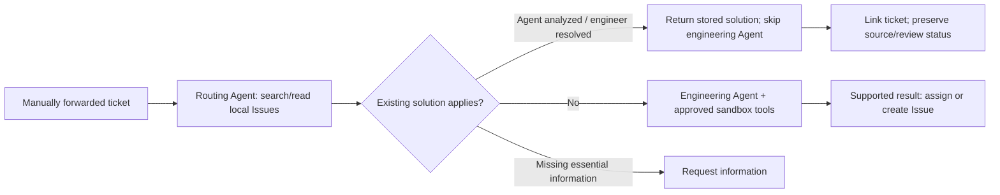

# Local Issue directory and routing

ESA keeps its database/JSON store as the authority. The local Issue directory is a generated read-only projection for Agent retrieval, not another editable issue database. Neither Issue bodies nor a top-N candidate list are sent in the initial Agent context. The provider receives a relative directory path and manifest hash; it resolves the path under its operator-configured local root.

## Workflow



Routing has only `issue_search` and `issue_read`. It cannot inspect product code, install software or run debugging tools. Only a new problem enters the engineering adapter and source registry. Reuse does not resolve source refs, prepare a runtime or invoke the engineering Agent. Each stage runs at most once per request; uncertain failures need explicit retry.

Both completed Agent proposals and engineer solutions can be reused. Engineer solutions take precedence when applicable; an Agent proposal need not wait for approval before reuse. Applicability remains a Routing Agent judgment about symptoms, component, version and environment. Agent proposals do not become trusted repairs through reuse. A reused engineer solution retains its source review provenance, while applicability to a new ticket remains reviewable. No ticket is automatically closed.

## Layout

```text
<issues-root>/
  projects/<project-key>/snapshots/<manifest-sha256>/
    README.md
    manifest.json
    index.jsonl
    agent_analyzed/<issue-key>/<scope-hash>/issue.json
    engineer_resolved/<issue-key>/<scope-hash>/issue.json
```

The index supports paginated search over title, source key, symptoms, diagnosis, component and version. Search returns bounded metadata with relative record paths and hashes; `issue_read` loads only selected records. Empty-query browsing handles differences in wording. The archive is not truncated to the first ten Issues or five cases.

A scope hash keeps different affected versions/environments separate within an Issue. Records contain the source ticket/run/solution or case revision, affected scope, original findings, diagnosis, solution and verification steps. Approved standalone resolved cases are included even when they predate an Engineering Issue; first reuse establishes their Issue association. For a given Issue/scope, an applicable reviewed solution replaces the pending proposal in the projection. Reused proposals do not create chains of copied catalogue entries.

Each view is built from revisions available at its frozen forwarding cutoff and limited to one project. Current private, rejected or withdrawn sources are excluded. Files and the manifest are hash-checked; path traversal and symlink escapes are denied. Reuse requires a successful read audit for the exact selected path/hash. Before publishing, ESA reconstructs the report from that record and rechecks the source against authoritative state. The Agent cannot supply a replacement solution body.

Views are immutable and published atomically. A later task gets a fresh eligible view after analysis, engineer review or source withdrawal. Older view files remain private audit artifacts and are never exposed to another task merely because they share a root. Do not edit them. Retention/garbage collection is operator-managed: preserve views referenced by active tasks or retained audits; there is no automatic archive deletion.

## Local service and Compose

```sh
mkdir -p runtime/esa/issues
bin/esa-host -store runtime/esa/state.json -issues-directory runtime/esa/issues
bin/esa-codex -registry runtime/releases.json -runs runtime/codex \
  -issues-directory runtime/esa/issues
```

Use the normal private tokens and provider URL from [ESA operations](ESA_OPERATIONS.md). Both processes must see the same directory contents; their absolute root paths may differ because only a root-relative view path is transmitted. The root and all generated files must be readable by the provider and writable only by the ESA service/operator.

Compose binds `ESA_ISSUES_DIRECTORY` (default `../../runtime/esa/issues`, relative to `deploy/redmine`) into ESA at `/var/lib/esa/issues`. Pre-create the host directory and ensure the container service user (UID 1000) can write it and the provider user can read it. Start the host provider with `-issues-directory` pointing to that host folder. A separately containerized provider should mount it read-only and use its own mount path. The named ESA state volume remains separate from this generated projection, including when PostgreSQL is the authority.

## Calls, usage and validation

`report.routing` records the decision, selected path/hash, reason and routing usage. `report.usage` aggregates actual routing and engineering calls/tokens. Reuse or clarification uses one routing call and zero engineering calls; new analysis normally uses two calls in total. `budget.max_calls: 1` is the per-stage invocation limit, not a claim that the complete workflow always costs one model call. The existing overall timeout and advisory per-ticket token thresholds still apply. Missing usage for either invoked stage makes the aggregate unknown.

Request, routing and engineering audits are stored beneath the provider's private per-run directory. Repeating a completed request returns its cached report; a partial/uncertain invocation is not silently retried. The replay tester continues to interact through public ESA APIs and does not implement this routing workflow itself.

Automated routing tests use a subprocess fixture and the real directory tool handlers: both Issue kinds skip engineering/source/runtime setup, unseen records cannot be reused, new problems invoke engineering once, and clarification invokes no engineering. Directory and application tests cover pagination, scope separation, historical cutoffs, withdrawal and source visibility. These tests verify orchestration and constraints, not model matching accuracy on real customer tickets.
